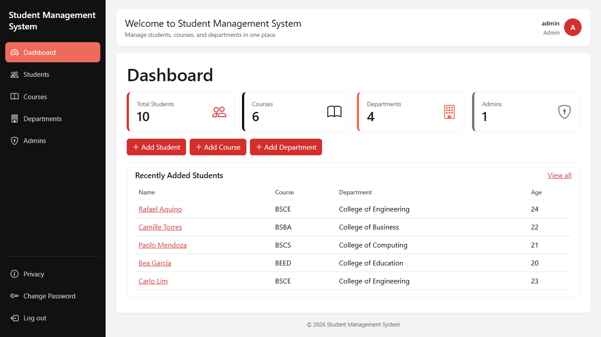
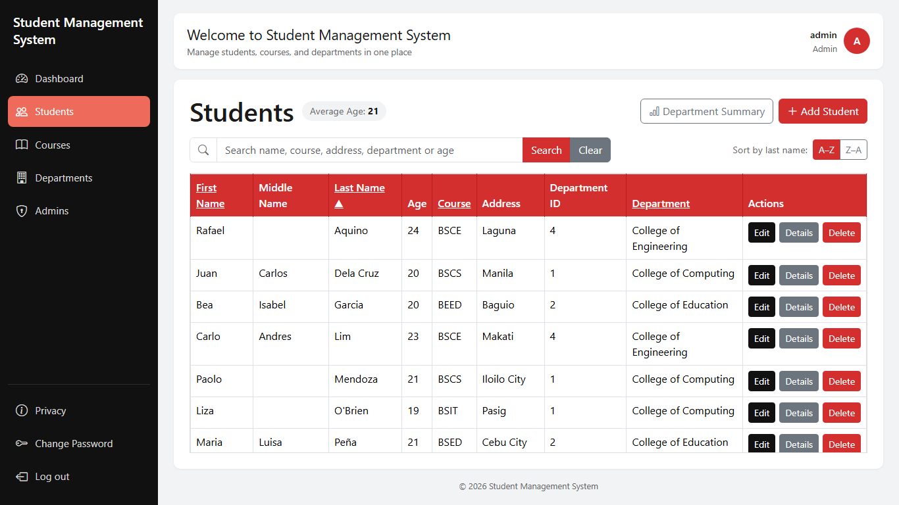
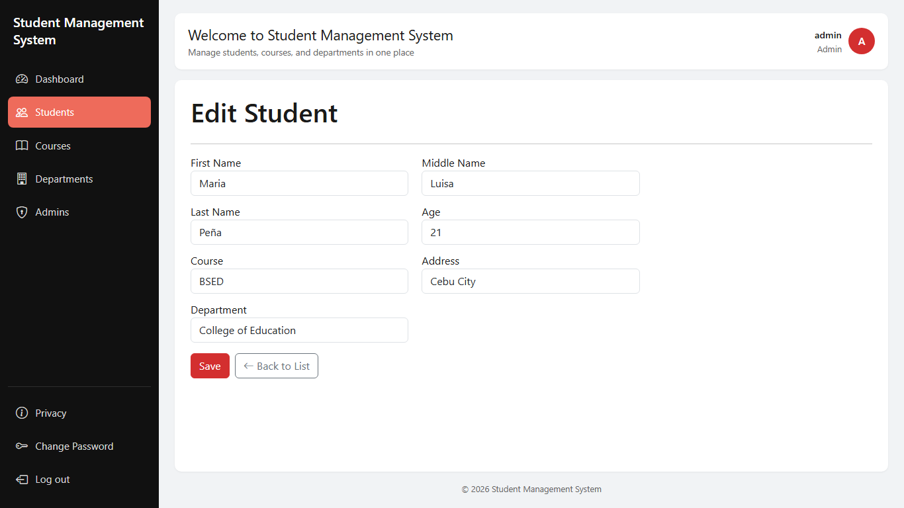
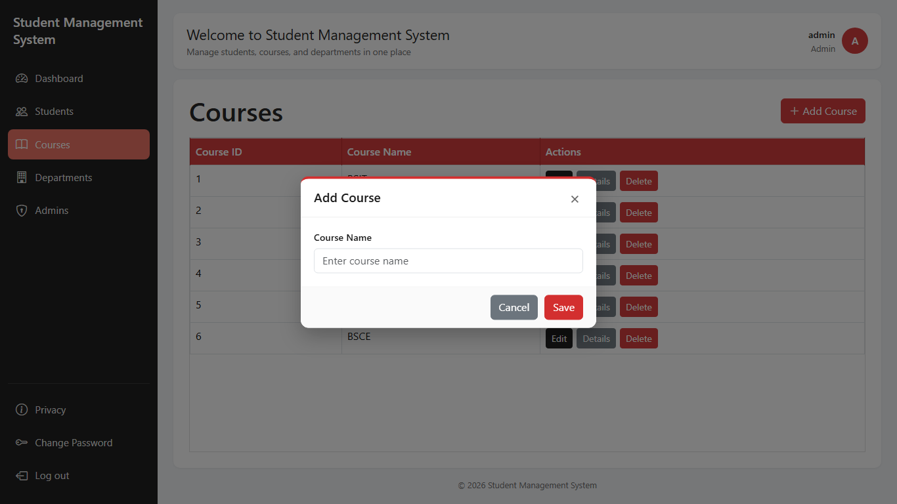
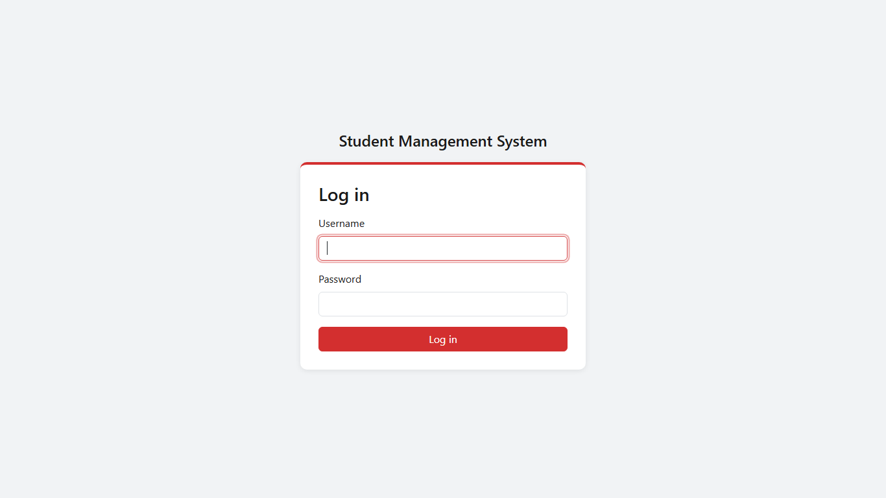

# Student Management System

**Status: Work in Progress**

A web-based student management system built with ASP.NET Core MVC, created as a portfolio project to practice full-stack .NET development and to mirror the records-management work I did during my government on-the-job training.

## Tech Stack

| Part | Technology |
|---|---|
| Framework | ASP.NET Core |
| Architecture | MVC (Model–View–Controller) |
| Language | C# |
| Frontend | Razor Views, HTML, CSS, JavaScript |
| Database | SQL Server |
| ORM | Entity Framework Core |
| IDE | Visual Studio 2022 |

## Features

- Manage student records (add, view, update, delete)
- Manage courses and departments
- Relational data linking students, courses, and departments through Entity Framework Core

## Screenshots

_The screenshots use sample data only._

**Dashboard:** totals, quick "Add" buttons, and the most recently added students



**Students:** search, sort by last name, and Edit / Details / Delete for each student



**Edit Student:** two-column form with validation



**Courses:** add, edit, view, and delete in popups



**Log in:** only admins can use the system



## How to Run

**You need:** the [.NET 9 SDK](https://dotnet.microsoft.com/download) and one of these (both free):
- **SQL Server Express**, or
- **SQL Server LocalDB**, which is already installed if you have Visual Studio with the "ASP.NET and web development" workload.

1. Download or clone this repository.
2. Open `StudentManagementSystem/appsettings.json` and set the `Server=` part of `DefaultConnection` to match your SQL Server:

   | You have | Use |
   |---|---|
   | SQL Server Express | `Server=.\\SQLEXPRESS;` (already set) |
   | LocalDB (Visual Studio) | `Server=(localdb)\\MSSQLLocalDB;` |

3. Run the app, from Visual Studio (press **F5**) or from a terminal in the `StudentManagementSystem` folder:
   ```
   dotnet run --launch-profile https
   ```
4. Open `https://localhost:7294`.
5. **First run only:** the app asks you to **create the first admin account**. Choose any username and a password (at least 8 characters), and you're logged in. This page closes itself once an admin exists. Your account is only on your own computer.

On the first run, the app also **creates the `StudentManagementDB` database and its tables by itself**. If the database already exists with tables, nothing is changed.

**Tip:** start by adding a few departments and courses, then add students.

## Project Structure

```
StudentManagementSystem
│
├── Controllers
│   ├── HomeController.cs           Dashboard (totals, recent students)
│   ├── StudentsController.cs       Students: list, search, sort, add, edit, delete
│   ├── CoursesController.cs        Courses: add, edit, delete
│   ├── DepartmentsController.cs    Departments: add, edit, delete
│   ├── AccountController.cs        Log in, log out, first-admin setup
│   └── AdminsController.cs         Add and remove admins, change your password
│
├── Models
│   ├── Student.cs
│   ├── Course.cs
│   ├── Department.cs
│   ├── Admin.cs                    Admin account (username + password hash)
│   └── StudentManagementDbContext.cs   Database tables (Entity Framework Core)
│
├── ViewModels
│   ├── LoginViewModel.cs           Login form fields and rules
│   ├── SetupViewModel.cs           New-admin form fields and rules
│   └── ChangePasswordViewModel.cs  Change Password form fields and rules
│
├── Views
│   ├── Home                        Dashboard
│   ├── Students                    List, Add, Edit, Details, Delete pages
│   ├── Courses                     List with popups
│   ├── Departments                 List with popups
│   ├── Account                     Login and Setup pages
│   ├── Admins                      Admin list, Add Admin, Change Password pages
│   └── Shared/_Layout.cshtml       Sidebar, welcome bar, page frame
│
├── wwwroot
│   ├── css/site.css                Base styles
│   ├── css/theme.css               Theme colors, layout, buttons, popups
│   └── js/site.js                  Course and department popups
│
├── Program.cs                      App setup: login, security, database creation
└── appsettings.json                Database connection setting
```

## What's Done

- [x] Project structure and database setup (the database and tables are created automatically on first run)
- [x] Student records: add, view, edit, delete
- [x] Course and department records: add, view, edit, delete
- [x] Department summary with a student count, and a list of students per department
- [x] Search and sorting of students
- [x] Input validation with clear error messages (names accept accents, apostrophes and hyphens, like Peña or O'Brien)
- [x] Data safety: courses and departments that still have students can't be deleted, and renaming a course updates its students
- [x] No duplicate course or department names (capital letters and extra spaces are ignored)
- [x] Admin login and logout, with first-time admin setup
- [x] Admin management: add and remove admin accounts
- [x] Change password: admins can change their own password (current password required)
- [x] Passwords stored as one-way hashes, never as plain text
- [x] Protection against forged requests (anti-forgery tokens) and against code hidden in names or addresses (XSS)
- [x] Visual design: black sidebar menu, red accent theme, and a welcome bar on every page
- [x] Dashboard with total counts, quick "Add" buttons, and the 5 most recently added students
- [x] Every page fits the screen; long tables scroll inside their own box (phones scroll normally)
- [x] Consistent buttons on all pages: Edit (black), Details (gray), Delete (red), Back to List
- [x] Styled popups for adding, editing, viewing, and deleting courses and departments

## What's Planned

- [ ] Link students to courses by ID (like departments), instead of by course name
- [ ] Demo mode with sample data, for an online demo

## Why I Built This

I wanted a project that reflects the kind of records-management work I did during my OJT, while giving me hands-on practice with a modern, industry-standard web stack (ASP.NET Core, EF Core, MVC) instead of just Windows-only desktop apps.
